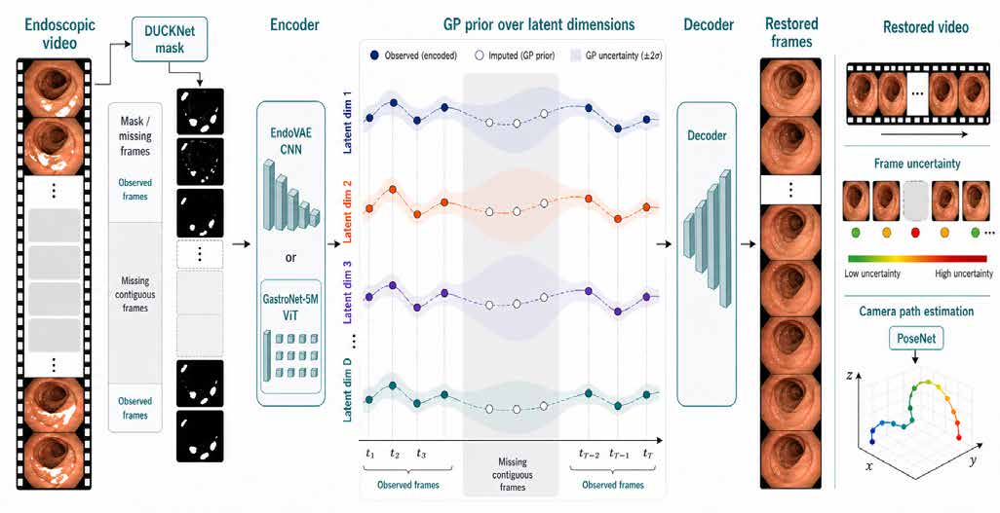
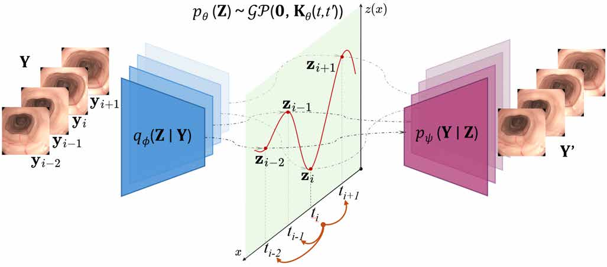
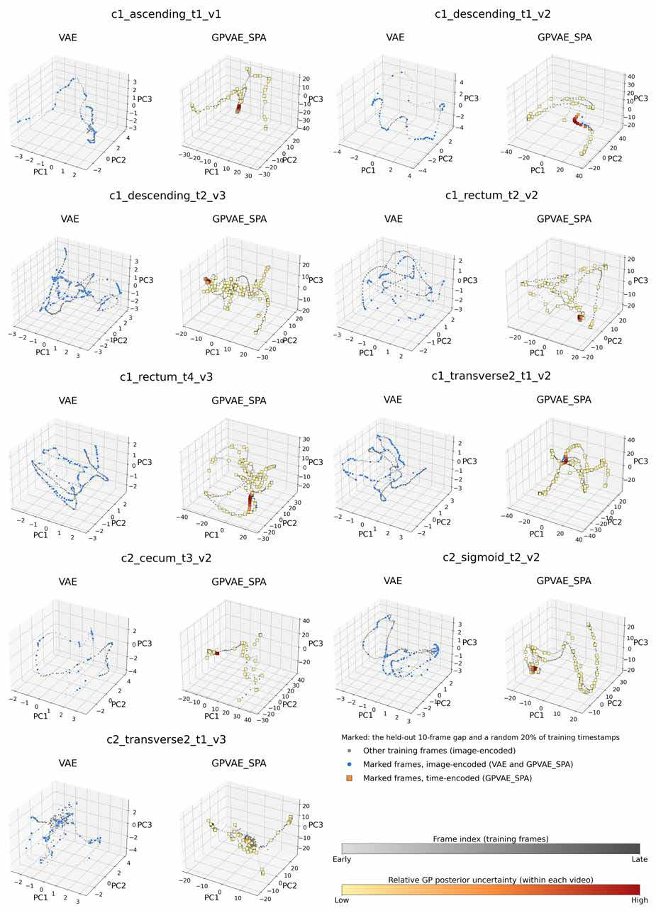
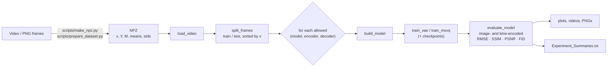
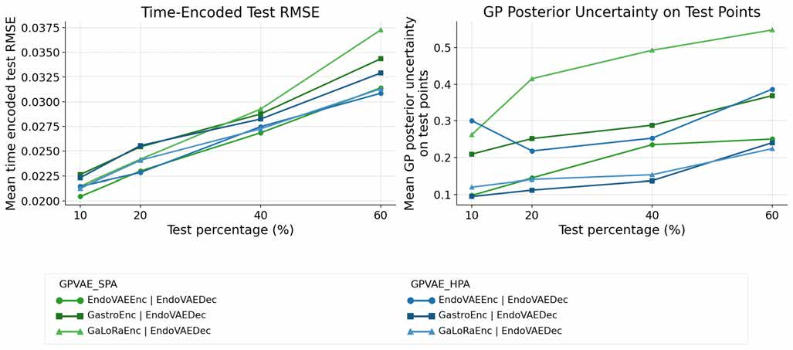
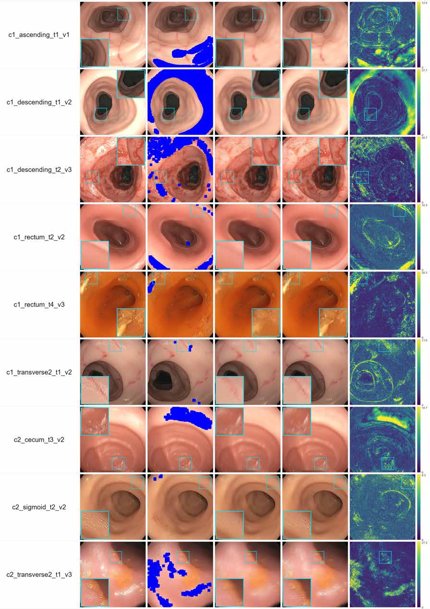

# GP-VAE for endoscopic videos

Code for *"Gaussian Process Prior Variational Autoencoder for Endoscopic Videos"* (De Boi et al.,
arXiv 2606.19908).

The model learns one endoscopy video at a time. A VAE compresses each 336 × 336 frame into a latent vector.
A Gaussian-process (GP) prior over the frame number ties the latents of nearby frames together, so the
model can decode a frame from its frame number alone. That is how it fills in frames it never saw
(missing, held-out or corrupted ones), while a valid-pixel mask keeps specular highlights out of the
reconstruction loss.

<p align="center">
  
</p>

*Overview (graphical abstract of the paper). Masked or missing frames are encoded where available; the GP
prior over each latent dimension fills the gap from the frame numbers, with an uncertainty band; the decoder
turns the latents back into frames.*

---

## Quick start

These four steps train and evaluate the models on one video. You need an NVIDIA GPU.

### 1. Set up the environment (once)

Install [`uv`](https://docs.astral.sh/uv/), which installs Python 3.12 and every library in the pinned
versions:

```bash
# Windows (PowerShell)
powershell -ExecutionPolicy ByPass -c "irm https://astral.sh/uv/install.ps1 | iex"
# Linux / macOS
curl -LsSf https://astral.sh/uv/install.sh | sh
```

Then, in the folder that contains this README:

```bash
uv sync                                                            # creates .venv (PyTorch 2.7.1 + CUDA 12.6)
uv run python -c "import torch; print(torch.cuda.is_available())"  # True = the GPU is found
```

### 2. Pretrained weights

> **Warning: the pretrained weights for `GastroEnc` and `GaLoRaEnc` are not public.** They come from other
> researchers and are **available upon request**. Put the file in `weights/dinov2_base.pth`. Without it,
> these two encoders stop with a `FileNotFoundError`.

- **`EndoVAEEnc` needs no restricted weights.** It is trained from scratch. The only other networks are VGG
  (for LPIPS) and Inception (for FID), which their libraries download automatically from public sources.
- So without these weights you can still run every model with `EndoVAEEnc`: set
  `GPVAE_ENCODERS=EndoVAEEnc` in step 4.
- Making a data file (step 3) needs the specular-highlight detector `weights/Duck16mod_Spec_99_new.pt`.

### 3. Get the data

The experiments use 9 C3VD videos, as in the paper, and 9 Kvasir-Capsule videos, an additional experiment
that is not in the paper:

| Dataset | Video names |
|---|---|
| C3VD | `c1_ascending_t1_v1`, `c1_descending_t1_v2`, `c1_descending_t2_v3`, `c1_rectum_t2_v2`, `c1_rectum_t4_v3`, `c1_transverse2_t1_v2`, `c2_cecum_t3_v2`, `c2_sigmoid_t2_v2`, `c2_transverse2_t1_v3` |
| Kvasir-Capsule | `kvasir_0728084c8da942d9`, `kvasir_07c1fa15a20a4398`, `kvasir_3c8d5f0b90d7475d`, `kvasir_4560e83f9afc4685`, `kvasir_7ad22d50ebaf4596`, `kvasir_b2134f4a6f864613`, `kvasir_d7a271f233ba4a40`, `kvasir_df6b47bafe5143f5`, `kvasir_fe5d372e43f94f68` (frame ranges below) |

Each video becomes one data file, `Data/<video> 336 X Ym01sGM.npz`, made with `scripts/make_npz.py`:

- **C3VD:** download [C3VDv2](https://durrlab.github.io/C3VDv2/) and point the script at the folder with
  the video's frames:

  ```bash
  uv run python scripts/make_npz.py --frames <folder with the frames of c1_descending_t1_v2> --name c1_descending_t1_v2 --out Data
  ```

- **Kvasir-Capsule:** download the videos from [the Kvasir-Capsule dataset](https://osf.io/dv2ag/). Each of
  the 9 videos uses its longest "Normal clean mucosa" segment, whole (0-based video frame numbers,
  first and last included):

  | Video | `--first` | `--last` |
  |---|---|---|
  | `df6b47bafe5143f5` | 2479 | 2883 |
  | `4560e83f9afc4685` | 6502 | 7209 |
  | `fe5d372e43f94f68` | 2250 | 2781 |
  | `d7a271f233ba4a40` | 10808 | 11175 |
  | `07c1fa15a20a4398` | 1353 | 1765 |
  | `3c8d5f0b90d7475d` | 10923 | 11427 |
  | `0728084c8da942d9` | 22803 | 23237 |
  | `7ad22d50ebaf4596` | 12362 | 12631 |
  | `b2134f4a6f864613` | 3771 | 4167 |

  For example:

  ```bash
  uv run python scripts/make_npz.py --video 7ad22d50ebaf4596.mp4 --first 12362 --last 12631 --name kvasir_7ad22d50ebaf4596 --out Data
  ```

More about the data files is in [Data](#3-data).

### 4. Train and evaluate

Train and evaluate the 9 combinations (`VAE`, `GPVAE_HPA`, `GPVAE_SPA` × `EndoVAEEnc`, `GastroEnc`,
`GaLoRaEnc`) on one video, with the settings in `configs/experiment.py` (300 epochs, 20 % of the frames held out as
test frames, seed 42; set `GPVAE_EPOCHS` for another number of epochs, e.g. `GPVAE_EPOCHS=500`):

```bash
# Linux / macOS / Git Bash
GPVAE_VIDEO=c1_descending_t1_v2 uv run python -m gpvae_endo run configs/experiment.py
```

```powershell
# Windows PowerShell
$env:GPVAE_VIDEO = "c1_descending_t1_v2"
uv run python -m gpvae_endo run configs/experiment.py
```

- To run only some models or encoders, set `GPVAE_MODELS` and/or `GPVAE_ENCODERS`, comma-separated. For
  example, `GPVAE_ENCODERS=EndoVAEEnc` runs the 3 models that need no restricted weights.
- Each model trains for up to 300 epochs, which took between 5 minutes and 1.5 hours per model on an
  A100 or P100 GPU, depending on the video and the encoder.
- The trained models are saved in `Saved_Models/`. To evaluate them again without training, run the same
  command with `configs/pretrained.py` instead of `configs/experiment.py`.
- Other settings files and options are described in [Running](#9-running).

The run writes the outputs described in [Outputs](#10-outputs):

- every metric per model, in `Experiment_Summaries.txt`;
- comparison images and a side-by-side video, in `Debug/`;
- every reconstructed frame, in `Recon/`;
- latent and GP plots, in `Pics/`.

---

## Contents

1. [Method](#1-method)
2. [Architecture](#2-architecture)
3. [Data](#3-data)
4. [Training](#4-training)
5. [Evaluation](#5-evaluation)
6. [Code layout](#6-code-layout)
7. [Configuration](#7-configuration)
8. [Installation](#8-installation)
9. [Running](#9-running)
10. [Outputs](#10-outputs)
11. [Tests](#11-tests)

---

## 1. Method

### Generative model

A video is a set of frames $y_1, \dots, y_N$ with frame numbers $x_1, \dots, x_N$. Each frame has a latent
vector $z_i \in \mathbb{R}^Q$ ($Q$ = `LATENT_DIM`, 256 by default).

<p align="center">
  
</p>

*The model (paper, Fig. 1). The encoder maps each frame to a latent point; a GP prior over the timestamps
couples the latents of neighbouring frames; the decoder maps the latents back to frames.*

| Part | Definition |
|---|---|
| Encoder (inference network) | $q(z_i \mid y_i) = \mathcal{N}(\mu_\phi(y_i), \operatorname{diag}\sigma^2_\phi(y_i))$ |
| Decoder | $\hat y_i = g_\theta(z_i)$, a deterministic image in the normalised pixel space |
| Prior, `VAE` | $p(z_i) = \mathcal{N}(0, I)$, independent across frames |
| Prior, GP-VAE models | For each latent dimension $q$ independently, $Z_{:,q} \mid x \sim \mathcal{N}(0, K_{xx} + \sigma_n^2 I)$ |

The GP kernel is a scaled Cauchy kernel over raw frame numbers (`KERNEL = 'CAUCHY'`):

$$k(x, x') = s \cdot \frac{1}{1 + (x - x')^2 / \ell^2}$$

Its hyper-parameters are learned with the networks, inside hard bounds (`gpvae_endo/gp/gp.py`): lengthscale
$\ell \in [1, 30]$ frames, output scale $s \in [0.5, 10]$, noise $\sigma_n^2 \in [10^{-3}, 1]$. With
`USE_X_SCALING = True` the frame numbers are min-max scaled to [0, 1] and the lengthscale bounds become
[0.025, 2]. RBF and Matérn kernels are also available.

### Objective

Every VAE-family model minimises, per mini-batch,

$$\mathcal{L} = w_\text{mse} \cdot \text{MSE}_M(\hat y, y) + w_\text{lpips} \cdot \text{LPIPS}(\hat y, y) + \beta(t) \cdot w_\text{kl} \cdot \text{KL}$$

with $z$ drawn by the reparameterisation trick.

- $\text{MSE}_M$ is the squared error summed over valid pixels only, divided by the number of valid pixels.
  The mask $M$ marks specular highlights and other artefacts as invalid (see [Data](#3-data)).
- LPIPS uses the VGG backbone. Both images are bilinearly resized to `LPIPS_RES` (256) first.
- The weights are `LOSS_WEIGHTS` = {mse 4, lpips 2, kl 1}. An optional PatchGAN term on the decoder output
  exists, but it is off (`MUST_USE_DECODER_GAN = False`).
- $\beta(t)$ is 0 for the first `WARMUP_EPOCHS` (50) epochs. It then ramps linearly to its maximum
  (`max_beta`) over `RAMP_EPOCHS` (50) epochs.

The models differ only in the KL term. `VAEModel.compute_kl_term` is the hook each subclass overrides.

| Model | KL term | Cost per step |
|---|---|---|
| `VAE` | $\text{KL}(q(z_i) \,\Vert\, \mathcal{N}(0, I))$, summed over $Q$, averaged over the batch | $O(bQ)$ |
| `GPVAE_Casale` | Exact $\text{KL}(q(Z) \,\Vert\, \mathcal{N}(0, K_{xx}))$ over all $N$ training frames (Casale et al. 2018). Re-encodes every frame at each step | $O(N^3 + NQ)$ |
| `GPVAE_HPA` | Neighbour-block approximation (Shi et al. 2025). For each batch frame $i$, take the block $B_i$ = {$i$ and its $H$ nearest frames in time}, `NR_OF_NEIGHBOURS` = 50. The KL is between $q(Z_{B_i})$ and the GP prior restricted to $B_i$, divided by the block size | $O(b H^3)$ |
| `GPVAE_SPA` | Neighbour conditional. The KL is between $q(z_i)$ and the GP conditional $p(z_i \mid z_{\text{nb}(i)}) = \mathcal{N}(\alpha_i^\top z_{\text{nb}(i)}, v_i)$, scaled by $N/b$ | $O(b H^3)$ |
| `MSVQ_VAE` | No KL. A multi-scale vector-quantised autoencoder with an EMA codebook and a commitment loss. It serves as a non-GP baseline | — |

HPA and SPA build a fixed k-nearest-neighbour graph over the frame numbers once, at construction.

HPA computes its block KL in closed form. The prior covariance $K_B$ is shared by all $Q$ latent dimensions
and the encoder covariance is diagonal, so
$\operatorname{tr}(K_B^{-1}S) = \sum_k (K_B^{-1})_{kk}\, s^2_k$ and the quadratic term is a single
contraction with $K_B^{-1}$. One batched Cholesky per block covers all dimensions
(`GPVAEHPAModel.hpa_kl_batch`).

### Inference from frame numbers ("time encoding")

After training, the GP models can predict a latent for any frame number $x_*$ by GP regression on the
encoded training latents $\mu$ (`GPVAECasaleModel.time_encode`):

$$\bar z_{*,q} = K_{*x}\,(K_{xx} + \sigma_n^2 I)^{-1}\,\mu_{:,q}, \qquad
\operatorname{Var}(z_*) = K_{**} - K_{*x}(K_{xx} + \sigma_n^2 I)^{-1}K_{x*}$$

The decoder turns $\bar z_*$ into a frame. This is how held-out frames are reconstructed without ever being
seen. The posterior variance is the same for every latent dimension. It is plotted as an uncertainty band.

<p align="center">
  
</p>

*Image-encoded vs time-encoded latents (paper, Fig. 8): 3-D PCA projections for `VAE` and `GPVAE_SPA`
(`EndoVAEEnc` + `EndoVAEDec`) on the nine C3VD videos, with a contiguous 10-frame gap held out. The squares
are latents predicted from the frame number alone. They follow the image-encoded trajectory, and their
GP uncertainty (yellow = low, red = high, scaled per video) rises inside the gap.*

---

## 2. Architecture

### Pipeline



`gpvae_endo/pipeline.py:run` carries out one experiment. It reads the config, opens a tee'd log, seeds the
RNGs and checks for a GPU. It then loads and splits the video and loops over every combination that
`ALLOWED_PAIRS_PER_MODEL` permits. Each combination is built, trained (or loaded from `Saved_Models/`),
saved, evaluated and summarised. All rows go into one table that is prepended to
`Experiment_Summaries.txt`.

### Model class hierarchy

```
nn.Module
└── VAEModel                      models/vae.py          networks, loss, N(0, I) KL, encode/decode, save/load
    └── GPVAECasaleModel          models/gpvae_casale.py GP prior object, exact KL, time_encode()
        └── NeighbourGPVAEModel   models/gpvae_neighbours.py  kNN graph
            ├── GPVAEHPAModel                             block KL
            └── GPVAESPAModel                             conditional KL
MSVQVAEModel                      models/msvq_vae.py     separate model and training loop (training/msvq_loop.py)
```

`VAEModel` mixes in `AdversarialMixin` (`models/adversarial.py`) for the optional decoder GAN.
`models/factory.py` builds a model from its name and works out its file name in `Saved_Models/`.

### Encoders

The encoder input is a batch of frames in `(B, H, W, C)` layout. Every encoder outputs `(mu, logvar)`, each
`(B, Q)`.

| Name | Class | Structure | Trainable |
|---|---|---|---|
| `EndoVAEEnc` | `networks/endovae.py:EndoVAEEncoder` | Stride-2 4×4 conv + ReLU stack: 336→168→84→42→21 px, channels 32→64→128→256 (stops at the 256-channel cap). Flattened (256·21·21 = 112,896) → `Linear` → 2Q | All |
| `GastroEnc` | `networks/vit.py:GastronetViTEncoder` | ViT-B/14 with pretrained weights from other researchers (`dinov2_base.pth`, available upon request). Input resized to 224 px; the 768-d CLS feature goes to an MLP head 768→1024→512→512→2Q (GELU, dropout 0.1) | Head only. The backbone is frozen, so its features are computed once for all frames and cached (`backbone_feats`) |
| `GaLoRaEnc` | `networks/vit.py:GastronetViTEncoderLoRABackbone` | Same ViT at 336 px. Rank-8 LoRA adapters (`networks/lora.py`) on the `qkv`, `proj`, `fc1` and `fc2` linears, plus the same MLP head | Head + LoRA adapters (`LORA_LR` = 1e-5) |
| `CNNEnc` | `networks/cnn.py:CNNEncoder` | Generic conv encoder that downsamples until the feature map is `MIN_SPATIAL` (8) | All |
| `MSVQEnc` | `networks/msvq.py:MSVQEncoder` | Multi-scale conv blocks (3×3, 5×5 and 7×7 branches). `MSVQ_VAE` only | All |

### Decoders

| Name | Class | Structure |
|---|---|---|
| `EndoVAEDec` | `networks/endovae.py:EndoVAEDecoder` | Mirror of `EndoVAEEnc`. Outputs logits in the normalised pixel space (no output activation) |
| `CNNDecRes` | `networks/cnn.py:CNNDecoderResidual` | Upsampling conv decoder with residual GroupNorm blocks (`networks/blocks.py`) |
| `MSVQDec` | `networks/msvq.py:MSVQDecoder` | Decoder of the quantised feature map. `MSVQ_VAE` only |

In `MSVQ_VAE` the encoder's feature map is flattened and mapped by a linear layer to a latent vector of
size `LATENT_DIM`. A second linear layer maps it back to a feature map, which is quantised against an
EMA-updated codebook of `CODEBOOK_SIZE` (256) entries before decoding. Its loss is
5 · masked MSE + 2 · LPIPS + 0.25 · commitment loss, with weights fixed in `models/msvq_vae.py`. It always
trains with batch size 8.

### Other networks

- `networks/duck_net.py`: DUCK-Net segmentation network. It is used only during data preparation, to mask
  specular highlights (`Duck16mod_Spec_99_new.pt`).
- `networks/gan.py`: PatchGAN discriminator with feature matching, used by the optional decoder GAN.

---

## 3. Data

### File format

Each video is one NPZ file, `Data/<video> 336 X Ym01sGM.npz`:

| Key | Shape | Content |
|---|---|---|
| `x` | `(N, 1)` int | Frame numbers, as in the source video. They need not be contiguous |
| `Y` | `(N, 336·336·3)` float32 | Frames, flattened HWC. RGB in [0, 1], then standardised per channel with fixed statistics: mean (0.640, 0.361, 0.313), std (0.190, 0.156, 0.141) |
| `M` | `(N, 336·336)` uint8 | Valid-pixel mask: 1 = use, 0 = artefact (specular highlight) |
| `means`, `stds` | `(3,)` | The normalisation above, used by `Denormaliser` to get back to RGB in [0, 1] |

### Making the NPZ

- `scripts/make_npz.py --video V.mp4 --first A --last B --name NAME --out Data` (or `--frames DIR`).
  It reads frames A..B (0-based, inclusive). Frames are resized so the shorter side is 336 px (Lanczos)
  and centre-cropped. The mask and normalisation come from `scripts/prepare_dataset.py`. At most
  `--max-frames` (2,000) frames are used.
- `scripts/prepare_dataset.py`: the folder-of-PNGs path, driven by `IMG_SRC_FOLDER`,
  `SUBSTRING_FILTER` and `RESOLUTION` in `config_endo.py`. It writes three normalisations; training reads
  only `Ym01sGM`.

The mask is the union of the enabled detectors (DUCK-Net speculars by default; banding, blur, threshold
specular and over-exposure detectors exist but are switched off). Mask previews go to `Resulting_Masks/`.
The DUCK-Net detector (`scripts/utils/MaskPixels.py:detect_specular_ducknet`) pads the frame with reflected
borders, runs the network at 256 × 256 and flags pixels with probability > 0.1. It also flags pixels with
grayscale intensity > 225, which the network can miss, and dilates the combined mask with a 5 × 5 kernel
twice. The second column of the figure in [Evaluation](#5-evaluation) shows the resulting masks in blue.

### Train/test split (`data/dataset.py:split_frames`)

- Default: `PERCENTAGE_FOR_TEST` (20 %) of the frames, drawn at random with a fixed `random_state=42`, so
  the test frames are the same for every seed.
- `MUST_USE_GAP_FOR_TEST`: instead, a contiguous block of `GAP_SIZE` frames in the middle of the video.
- `PERCENTAGE_FOR_TAIL`: additionally holds out the last part of the video (extrapolation).

Both sets are sorted by frame number. The models see raw frame numbers unless `USE_X_SCALING = True`.

---

## 4. Training

`training/loop.py:train_vae` trains `VAE`, `GPVAE_*`; `training/msvq_loop.py:train_msvq` trains
`MSVQ_VAE`. Each epoch:

1. Shuffle the training frames. For each mini-batch (`BATCH_SIZE`, 64):
   1. encode, sample $z$, decode;
   2. compute the loss (`compute_total_loss`);
   3. back-propagate and clip the gradient norm to 1.0 (encoder, decoder and GP hyper-parameters);
   4. take an Adam step. A batch with a non-finite loss is skipped.
2. Record the epoch means of every loss component and log one line with the losses, β, the learning rate
   and, for GP models, the current ℓ, s and σ²ₙ.
3. Early stopping: `EARLY_STOPPING_PATIENCE` (25) epochs without improvement, checked only after
   `EARLY_STOPPING_START_FRACTION` (50 %) of the epochs. Then step the LR schedule.

**Optimiser and schedule.** Adam with learning rate `LEARNING_RATE` (1e-3). The GP hyper-parameters get
10× that rate. The LR warms up linearly from 0.1× to 1× over `WARMUP_EPOCHS`, then decays with a cosine
schedule to 1e-5.

**Frozen ViT cache.** For `GastroEnc`, the backbone runs once over all frames at construction. Training
then runs only the MLP head on the cached features.

**Best epoch.** The weights of the epoch with the lowest training loss are kept as a CPU copy and
restored at the end. Only epochs at the full KL weight ($\beta = $ `max_beta`) are candidates; earlier
epochs have a lower loss only because β is lower. If training stops before β reaches its maximum, the last
epoch is kept. Afterwards every training frame is encoded once more. The means become `model.Z` /
`model.mu_all`, and the GP regression in `time_encode` conditions on them.

**Checkpointing** (`training/checkpoint.py`, enabled with `--checkpoint`). The loop saves its full state
at epoch boundaries: weights (loaded back *into* the existing modules, because the optimiser holds
references to them), optimiser, both LR schedulers, early-stopping tracker, best-epoch snapshot, loss
histories and every RNG state. A save happens every `--checkpoint-interval` seconds (900) and when the
next epoch would end within `--deadline-margin` seconds of the job's time limit (read from
`SLURM_JOB_END_TIME` when the run is a Slurm job; without it there is no time limit). In the second case the
process exits with code **85** ("saved, run me again"). A resumed run is bit-identical to an uninterrupted
one. Writes are atomic. Resuming refuses a checkpoint whose settings fingerprint differs from the current
run.

**Device.** Training needs CUDA. Without a GPU the run stops with exit code 1, unless `GPVAE_ALLOW_CPU=1`
is set.

---

## 5. Evaluation

`evaluation/evaluate.py:evaluate_model` reconstructs frames in two ways:

| Suffix | Path | Available for |
|---|---|---|
| `im` (image-encoded) | frame → encoder mean → decoder | All models |
| `t` (time-encoded) | frame number → `time_encode` (GP posterior mean) → decoder | GP-VAE models only |

Both paths run on training (`tr`) and test (`te`) frames. **`te_t` is the main metric**: it measures how
well the model reconstructs frames it never saw, from their position in time alone.

<p align="center">
  
</p>

*Held-out frames vs test percentage (paper, Fig. 3), averaged over the nine C3VD videos. Left: `te_t` RMSE
of the six GP-VAE configurations at 10–60 % held-out frames. Right: their mean GP posterior uncertainty on
the held-out frames. Its level depends on the learned kernel hyper-parameters, so compare it within one
configuration, not across configurations.*

Metrics (`evaluation/metrics.py`) are computed on frames denormalised to RGB in [0, 1]. With
`MUST_USE_MASK`, they cover only the valid pixels.

| Metric | Implementation | Better |
|---|---|---|
| RMSE | Per-pixel root-mean-square error | lower |
| SSIM | Masked SSIM | higher |
| PSNR | Masked PSNR, data range 1 | higher |
| FID | `torchmetrics` `FrechetInceptionDistance`, 2048-d Inception features, uint8 frames | lower |

Each model also gets the following outputs:

- loss curves and RMSE per frame;
- latent trajectories, with optional 2-D and PCA plots;
- the GP posterior per latent dimension with its uncertainty band;
- the prior covariance (optional);
- comparison images and a side-by-side MP4 (original | original with mask | reconstruction);
- every reconstructed frame as a PNG (`MUST_RECONSTRUCT_ALL`).

<p align="center">
  
</p>

*Frame 50 of each C3VD video (paper, Fig. 2). Columns: original frame, valid-pixel mask (invalid pixels in
blue), `VAE` reconstruction, `GPVAE_HPA` reconstruction (both `EndoVAEEnc` + `EndoVAEDec`), and the
difference between the two reconstructions, scaled per video. The cyan box marks the 64 × 64 region where
the two reconstructions differ most; it is magnified in the insets. The `VAE` reconstructions are blurrier.*

Evaluation runs its steps in a fixed order, because some of them draw random numbers, which affects the
initialisation of the next model in the same run.

---

## 6. Code layout

```
gpvae_endo/                    the package
  __main__.py, cli.py          command line: python -m gpvae_endo run [config] [--checkpoint ...]
  pipeline.py                  one experiment run, end to end
  config.py                    ExperimentConfig / ModelSettings, read from Python config files
  paths.py                     output folders (created on demand), weights folder lookup
  data/dataset.py              NPZ loading, train/test split, frame-number scaling
  networks/                    endovae.py, cnn.py, vit.py + lora.py, msvq.py, gan.py, blocks.py,
                               duck_net.py, dinov2/ (ViT backbone code)
  gp/gp.py, gp/kernels.py      GPyTorch ExactGP with bounded hyper-parameters; Cauchy kernel
  models/                      vae.py, gpvae_casale.py, gpvae_neighbours.py (HPA, SPA), msvq_vae.py,
                               adversarial.py (decoder GAN mixin), factory.py
  training/                    loop.py, msvq_loop.py, checkpoint.py, progress.py (early stopping)
  evaluation/                  evaluate.py (post-training pipeline), metrics.py
  viz/                         training curves, latents, GP posterior, image comparisons, videos
  reporting/summary.py         the Experiment_Summaries table
  utils/                       device check, seeding/RNG state, Tee logging, atomic writes
config_endo.py                 base settings
configs/config_c*.py           one settings file per C3VD video
configs/experiment.py          run settings: config_endo.py + 300 epochs, video/models/encoders/seed
                               from GPVAE_* environment variables
configs/pretrained.py          configs/experiment.py, but loads the models in Saved_Models/ (evaluate again, no training)
Latent_Space_Discovery.py      alternative entry point; wraps gpvae_endo.pipeline.run
scripts/                       make_npz.py, prepare_dataset.py, parse_experiment_summaries.py,
                               utils/ (one-off analysis and plotting scripts)
docs/figures/                  figures from the paper, used in this README
tests/                         pytest suite
```

---

## 7. Configuration

Settings are plain Python modules; every `UPPER_CASE` name is a setting. `config.py` turns them into two
frozen dataclasses:

- **`ExperimentConfig`** is read from the file passed on the command line (default `config_endo.py`). It
  holds the video (`SUBSTRING_FILTER`, `RESOLUTION`), the models, encoders and decoders to train plus
  `ALLOWED_PAIRS_PER_MODEL`, `EPOCHS`, `LATENT_DIM`, `BATCH_SIZE`, `LEARNING_RATE`, `KERNEL`,
  `NR_OF_NEIGHBOURS`, the split, the folders, the metric and plot switches, and `SEED`.
- **`ModelSettings`** is **always read from `config_endo.py`**, whatever file is passed. It holds the loss
  weights, warm-up and ramp, LPIPS resolution, early stopping, LoRA, GAN and `USE_X_SCALING`. A run config
  that sets one of these to a different value gets a printed `WARNING ... ignored`.

`config_endo.py` has two blocks selected by `is_on_HPC`: full runs (500 epochs, batch 64, LPIPS at 256 px)
and quick local tests (100 epochs, batch 8, LPIPS at 32 px). Config files seed the RNGs when executed, so
they are read before the run seeds them with `SEED`.

Weights are looked up in `weights/`, then `Models/Weights/`. `dinov2_base.pth` (for `GastroEnc` and
`GaLoRaEnc`) is not public; it is available upon request (see
[Pretrained weights](#2-pretrained-weights)). The VGG weights (for LPIPS) and the Inception weights (for FID)
are downloaded by their libraries.

---

## 8. Installation

Requirements: Python 3.12 (managed by `uv`), an NVIDIA GPU with a recent driver, Windows or Linux. PyTorch
2.7.1 with CUDA 12.6 wheels comes from the PyTorch index. All versions are pinned in `uv.lock`.

```bash
uv sync                    # creates .venv
uv sync --group dev        # + pytest
uv run python -c "import torch; print(torch.cuda.is_available())"
```

Put the data in `Data/` and the weights in `weights/`:

- `weights/dinov2_base.pth`, needed for `GastroEnc` and `GaLoRaEnc`. **Not public**: available upon request
  (see [Pretrained weights](#2-pretrained-weights));
- `weights/Duck16mod_Spec_99_new.pt`, needed for data preparation.

---

## 9. Running

```bash
uv run python -m gpvae_endo run                                        # config_endo.py
uv run python -m gpvae_endo run configs/config_c1_descending_t1_v2.py  # a specific config
uv run python -m gpvae_endo run configs/<file>.py --checkpoint         # with checkpoint/resume
uv run python Latent_Space_Discovery.py --config configs/<file>.py     # alternative entry point, same thing
```

| Option | Default | Meaning |
|---|---|---|
| `--checkpoint` | off | Save training state and resume from `Saved_Models/<model>.ckpt.pt` |
| `--checkpoint-interval S` | 900 | Seconds between checkpoints |
| `--deadline-margin S` | 600 | Stop and exit 85 this many seconds before the job's time limit (`SLURM_JOB_END_TIME`, if set) |
| `--stop-after-epochs N` | — | Testing: save and exit 85 after N epochs |

Exit codes: 0 = done, 85 = checkpoint saved (run again to continue), 1 = no GPU, other = error.

For a small smoke run, add this to the end of a copy of `config_endo.py`:

```python
MODELS = ['VAE', 'GPVAE_HPA']
ENCODERS = ['EndoVAEEnc']
DECODERS = ['EndoVAEDec']
EPOCHS = 5
```

---

## 10. Outputs

All outputs are written relative to the working directory.

| Path | Content |
|---|---|
| `Experiment_Summaries.txt` | One table per run, newest first: a row per model with every metric, training time and epochs |
| `Logs/` | Full stdout of each run |
| `Saved_Models/*.pth` | Trained models (`state_dict_full`: networks, GP state, latents, loss histories). Reused when `MUST_ALWAYS_TRAIN_FROM_SCRATCH = False` |
| `Saved_Models/*.ckpt.pt` | Training checkpoints (`--checkpoint`) |
| `Pics/` | Loss curves, RMSE per frame, latent plots, GP posterior and covariance plots |
| `Debug/<video>/` | Comparison images and the side-by-side MP4 |
| `Recon/<video>/Frames/` | Every reconstructed frame as a PNG (`C:/Endo/Recon/` when `is_on_HPC = False`) |

`scripts/parse_experiment_summaries.py` turns the summary tables into CSV.

---

## 11. Tests

```bash
uv run pytest -m "not slow"    # ~2 min on a CPU
uv run pytest                  # + the two ViT cases (needs dinov2_base.pth, ~6 min more)
```

| Test | What it checks |
|---|---|
| `tests/test_equivalence.py` | Trains tiny models and compares every loss, learning rate, weight and output with recorded reference values (`tests/equivalence/legacy_reference.json`). Exact, except `GPVAE_HPA` at tolerance 1e-4. Also checks that the best epoch is restored |
| `tests/test_checkpoint.py` | A run that is stopped and resumed equals an uninterrupted run, bit for bit |
| `tests/test_hpa_kl.py` | The closed-form HPA block KL against a per-dimension reference computation |
| `tests/test_metrics.py` | Denormalisation and metrics |
| `tests/test_device.py` | The missing-GPU check and `GPVAE_ALLOW_CPU` |
| `tests/test_experiment_config.py` | `configs/experiment.py`: defaults, environment variables, rejected typos |
